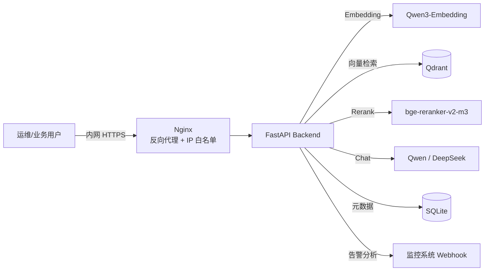

# OpsRAG Copilot
> 企业私有云智能运维与 RAG 知识协作平台 · 100% 内网部署 · 数据不出域


## 背景
企业内网环境下，运维团队面临三个痛点：
- **数据安全红线**：运维日志、SOP 不能出内网，无法使用 SaaS 大模型
- **排障依赖人工经验**：常见告警处理流程分散在个人经验里，新人上手慢
- **文档检索低效**：历史手册散落在 Wiki / 共享盘，关键词搜索命中率低
本项目在信创私有云环境中搭建了一套 **"大模型 + RAG + 运维辅助"** 的协作平台，
所有组件开源、数据本地化，通过 IP 白名单 + API Key 双重管控。
## 架构

## 核心能力
| 能力 | 说明 |
| --- | --- |
| 私有化部署 | Docker Compose 编排 Qdrant / Embedding / Reranker / LLM / Backend / Nginx |
| RAG 知识库 | 多格式解析（PDF/Word/MD/TXT）+ 递归切分 + 向量化 + Reranker 重排 |
| 运维 Agent | 告警 → Prompt 模板 → 日志提取 → 初步分析，对接任意监控 Webhook |
| 访问控制 | IP 白名单中间件 + API Key 鉴权 + 文档审核接口 |
| 降级兜底 | 大模型不可用时自动返回"检索原文 + 兜底话术"，保证可用性 |
## 技术栈
- **LLM**：Qwen2.5-14B / DeepSeek（vLLM / Ollama 部署）
- **Embedding**：Qwen3-Embedding-0.6B（TEI）
- **Reranker**：bge-reranker-v2-m3（TEI）
- **向量库**：Qdrant
- **后端**：FastAPI + httpx + SQLite
- **网关**：Nginx（反向代理 + IP 白名单）
- **部署**：Docker Compose，支持离线镜像 + 模型挂载
## 关键设计
- **检索精度优化**：向量召回 Top-20 → Reranker 精排 Top-5，解决长文档检索不准与大模型幻觉
- **降级策略**：Reranker 超时自动退化为向量序；LLM 不可用返回原文 + 兜底话术
- **权限隔离**：文档 payload 带 `dept` 字段，检索时强制过滤，实现部门级知识隔离
- **双层白名单**：Nginx `geo` + 后端中间件双校验，防止绕过代理
## 目录结构
```
backend/app/rag      # 切分 / 向量化 / 检索 / 重排
backend/app/agent    # 告警分析 Agent + Prompt 模板
backend/app/core     # 鉴权 / IP 白名单 / LLM 客户端
deploy/nginx         # 反向代理配置
docs/                # 架构 / 部署 / 用户 SOP
```
## 部署
> 运行阶段无外联，部署阶段支持离线镜像 + 本地模型目录。
> 详细步骤见 [docs/DEPLOYMENT.md](docs/DEPLOYMENT.md)。
```bash
cp .env.example .env
docker compose up -d --build
```
## License
MIT © 2025 OpsRAG Copilot
